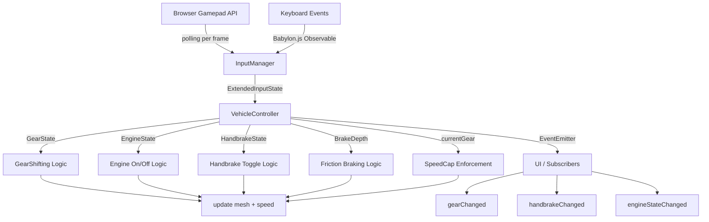
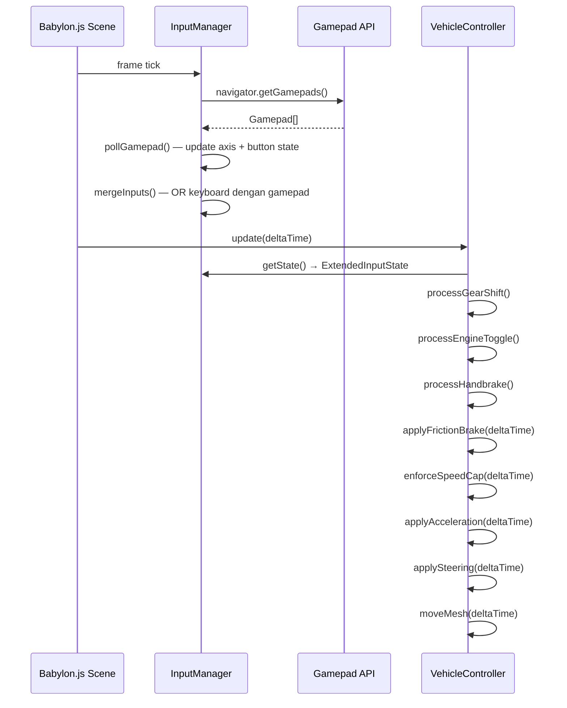
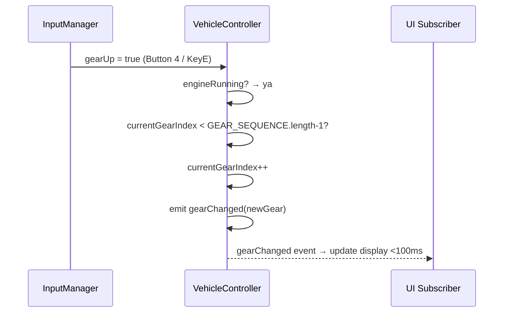

# Dokumen Desain: Vehicle Controller Features

## Ikhtisar

Dokumen ini menjelaskan desain teknis untuk memperluas `VehicleController` dan `InputManager` di frontend Babylon.js (TypeScript). Enam fitur baru ditambahkan: perpindahan gigi manual, pengereman bertahap (friction braking), handbrake toggle, batasan kecepatan per gigi (speed cap), start/stop engine, dan integrasi gamepad Ryunix Kaiju XR1 via Gamepad API browser.

Pendekatan desain mempertahankan arsitektur kelas yang sudah ada dan memperluas `InputState` serta `VehicleOptions` tanpa memecah kontrak API yang sudah ada. Semua state baru dikelola di dalam `VehicleController`, sementara `InputManager` diperluas dengan layer polling gamepad yang berjalan paralel dengan listener keyboard yang sudah ada.

---

## Arsitektur




## Diagram Alur Utama

### Alur Update per Frame



### Alur Perpindahan Gigi



---

## Tipe dan Interface Baru

### Perluasan `InputState` → `ExtendedInputState`

`InputState` yang ada di `game.types.ts` hanya mencakup input boolean keyboard dasar. Fitur baru membutuhkan field tambahan untuk axis analog gamepad dan aksi kendaraan baru.

```typescript
// frontend/src/game/types/game.types.ts — tambahan field

export interface InputState {
  // --- field yang sudah ada ---
  forward: boolean
  backward: boolean
  left: boolean
  right: boolean
  jump: boolean
  sprint: boolean
  interact: boolean
  mouseX: number
  mouseY: number
  mouseDeltaX: number
  mouseDeltaY: number

  // --- field baru untuk fitur kendaraan ---
  /** Nilai axis gas dari gamepad [0.0–1.0]. Keyboard forward = 1.0 jika ditekan. */
  throttleAxis: number
  /** Nilai axis rem dari gamepad [0.0–1.0]. Keyboard brake = 1.0 jika ditekan. */
  brakeAxis: number
  /** Naik gigi: Button 4 gamepad atau KeyE */
  gearUp: boolean
  /** Turun gigi: Button 5 gamepad atau KeyQ */
  gearDown: boolean
  /** Toggle handbrake: Button 1 gamepad atau tombol terkonfigurasi */
  handbrakeToggle: boolean
  /** Toggle engine: Button 2 gamepad atau tombol terkonfigurasi */
  engineToggle: boolean
}
```


### Perluasan `VehicleOptions`

```typescript
// frontend/src/game/engine/VehicleController.ts

export type VehicleOptions = {
  // --- field yang sudah ada ---
  maxSpeed?: number
  accel?: number
  brakeAccel?: number
  turnSpeed?: number
  reverseMaxSpeed?: number

  // --- field baru ---
  /** SpeedCap per gigi (unit/s). Jika tidak disediakan, gunakan GEAR_SPEED_CAPS default. */
  gearSpeedCaps?: Partial<Record<GearPosition, number>>
  /** Faktor deselerasi saat turun gigi melebihi SpeedCap (default: 5.0) */
  gearDownDecelFactor?: number
  /** Multiplier FrictionDecel saat handbrake aktif (default: 1.5) */
  handbrakeMultiplier?: number
}
```

### Tipe State Kendaraan Baru

```typescript
// Urutan gigi sebagai array literal untuk memudahkan navigasi indeks
export const GEAR_SEQUENCE = ['R', 'N', '1', '2', '3', '4', '5', '6'] as const
export type GearPosition = typeof GEAR_SEQUENCE[number]

// Tabel lookup SpeedCap per gigi (unit/s)
export const GEAR_SPEED_CAPS: Record<GearPosition, number> = {
  R: 10,
  N: 0,
  '1': 29,
  '2': 50,
  '3': 75,
  '4': 100,
  '5': 130,
  '6': 160,
}

// Payload event yang dipancarkan VehicleController
export interface GearChangedPayload  { gear: GearPosition }
export interface HandbrakeChangedPayload { active: boolean }
export interface EngineStateChangedPayload { running: boolean }

// State internal kendaraan (untuk keperluan debug/serialisasi)
export interface VehicleState {
  currentGear: GearPosition
  engineRunning: boolean
  handbrakeActive: boolean
  speed: number
  brakeDepth: number
}
```


---

## Perubahan pada `InputManager`

### Mapping Tombol Gamepad

| Aksi              | Button Index | Keyboard Default |
|-------------------|:---:|-----------------|
| Handbrake Toggle  | 0 (Button 1) | `Space` (dapat dikonfigurasi) |
| Engine Toggle     | 1 (Button 2) | `KeyR` (dapat dikonfigurasi) |
| Gear Up           | 3 (Button 4) | `KeyE` |
| Gear Down         | 4 (Button 5) | `KeyQ` |
| Throttle          | Axis 5 (R2)  | `KeyW` / `ArrowUp` (boolean → 1.0) |
| Brake             | Axis 2 (L2)  | `KeyS` / `ArrowDown` (boolean → 1.0) |

> **Catatan mapping axis**: Nilai raw axis R2/L2 pada Gamepad API biasanya berada di rentang [-1.0, 1.0] di mana -1.0 = tidak ditekan dan 1.0 = ditekan penuh. `InputManager` akan menormalkan ke [0.0, 1.0] dengan rumus `(rawValue + 1) / 2`.

### Perluasan `KeyBindings`

```typescript
export interface KeyBindings {
  // --- field yang sudah ada ---
  forward: string[]
  backward: string[]
  left: string[]
  right: string[]
  jump: string[]
  sprint: string[]
  interact: string[]

  // --- field baru ---
  gearUp: string[]          // default: ['KeyE']
  gearDown: string[]        // default: ['KeyQ']
  handbrake: string[]       // default: ['Space']
  engineToggle: string[]    // default: ['KeyR']
  brake: string[]           // default: ['KeyS', 'ArrowDown'] (sudah ada sebagai 'backward')
}
```


### Metode Baru di `InputManager`

```typescript
class InputManager {
  // --- field baru ---
  private activeGamepadIndex: number | null = null
  private gamepadButtonPrev: boolean[] = []   // state frame sebelumnya untuk edge detection

  // --- metode publik baru ---

  /**
   * Mengembalikan nilai mentah axis dari Gamepad API, di-clamp ke [-1.0, 1.0].
   * Jika tidak ada gamepad aktif, mengembalikan 0.
   */
  getGamepadAxisValue(axisIndex: number): number

  /**
   * Polling gamepad — dipanggil sekali per frame sebelum getState().
   * Membaca semua axis dan button, lalu menggabungkan (OR) dengan input keyboard.
   * Mendeteksi edge press (rising edge) untuk tombol toggle.
   */
  private pollGamepad(): void

  /**
   * Menormalkan axis trigger dari [-1, 1] ke [0, 1].
   * raw = -1.0 → 0.0 (tidak ditekan), raw = 1.0 → 1.0 (penuh)
   */
  private normalizeTriggerAxis(raw: number): number
}
```

### Algoritma `pollGamepad()`

```pascal
PROCEDURE pollGamepad()
  gamepads ← navigator.getGamepads()
  
  IF activeGamepadIndex IS NULL OR gamepads[activeGamepadIndex] IS NULL THEN
    RETURN  // tidak ada gamepad, semua field gamepad tetap 0/false
  END IF
  
  gp ← gamepads[activeGamepadIndex]
  
  // Baca axis
  throttleRaw ← gp.axes[5]  // R2
  brakeRaw    ← gp.axes[2]  // L2
  state.throttleAxis ← max(normalizeTriggerAxis(throttleRaw), state.forward ? 1.0 : 0.0)
  state.brakeAxis    ← max(normalizeTriggerAxis(brakeRaw),    state.backward ? 1.0 : 0.0)
  
  // Baca button dengan edge detection (rising edge = baru ditekan frame ini)
  btn0Pressed ← gp.buttons[0].pressed
  btn1Pressed ← gp.buttons[1].pressed
  btn3Pressed ← gp.buttons[3].pressed
  btn4Pressed ← gp.buttons[4].pressed
  
  state.handbrakeToggle ← (btn0Pressed AND NOT gamepadButtonPrev[0])
                           OR isKeyJustPressed(keyBindings.handbrake)
  state.engineToggle    ← (btn1Pressed AND NOT gamepadButtonPrev[1])
                           OR isKeyJustPressed(keyBindings.engineToggle)
  state.gearUp          ← (btn3Pressed AND NOT gamepadButtonPrev[3])
                           OR isKeyJustPressed(keyBindings.gearUp)
  state.gearDown        ← (btn4Pressed AND NOT gamepadButtonPrev[4])
                           OR isKeyJustPressed(keyBindings.gearDown)
  
  // Simpan state button untuk frame berikutnya
  gamepadButtonPrev[0] ← btn0Pressed
  gamepadButtonPrev[1] ← btn1Pressed
  gamepadButtonPrev[3] ← btn3Pressed
  gamepadButtonPrev[4] ← btn4Pressed
END PROCEDURE
```

> `isKeyJustPressed` hanya mengembalikan `true` pada frame pertama tombol keyboard ditekan (rising edge), mirip dengan gamepad edge detection.


### Registrasi Event Gamepad

```typescript
// Dipanggil di constructor InputManager
private setupGamepadListeners(): void {
  window.addEventListener('gamepadconnected', (e: GamepadEvent) => {
    this.activeGamepadIndex = e.gamepad.index
    this.gamepadButtonPrev = new Array(e.gamepad.buttons.length).fill(false)
    console.log(`[InputManager] Gamepad terhubung: ${e.gamepad.id}`)
  })

  window.addEventListener('gamepaddisconnected', (e: GamepadEvent) => {
    if (this.activeGamepadIndex === e.gamepad.index) {
      this.activeGamepadIndex = null
      this.gamepadButtonPrev = []
      // Reset semua field gamepad ke default
      this.state.throttleAxis = this.state.forward ? 1.0 : 0.0
      this.state.brakeAxis    = this.state.backward ? 1.0 : 0.0
      this.state.gearUp          = false
      this.state.gearDown        = false
      this.state.handbrakeToggle = false
      this.state.engineToggle    = false
      console.log(`[InputManager] Gamepad terputus: ${e.gamepad.id}`)
    }
  })
}
```

---

## Perubahan pada `VehicleController`

### State Internal Baru

```typescript
class VehicleController {
  // --- field yang sudah ada ---
  private mesh: AbstractMesh
  private input: InputManager
  private speed = 0
  private heading = 0
  private targetSpeed = 0
  private opts: Required<VehicleOptions>

  // --- field baru ---
  private currentGearIndex = 1          // index di GEAR_SEQUENCE, default 'N' (index 1)
  private engineRunning = false          // engine mati saat spawn
  private handbrakeActive = false        // handbrake nonaktif saat spawn

  // Event emitter sederhana (tidak perlu library eksternal)
  private listeners: {
    gearChanged:         Array<(payload: GearChangedPayload) => void>
    handbrakeChanged:    Array<(payload: HandbrakeChangedPayload) => void>
    engineStateChanged:  Array<(payload: EngineStateChangedPayload) => void>
  } = { gearChanged: [], handbrakeChanged: [], engineStateChanged: [] }
}
```


### Event Emitter Pattern

`VehicleController` mengimplementasikan event emitter ringan tanpa dependensi eksternal.

```typescript
// Tambahkan listener
on(event: 'gearChanged',        cb: (p: GearChangedPayload) => void): () => void
on(event: 'handbrakeChanged',   cb: (p: HandbrakeChangedPayload) => void): () => void
on(event: 'engineStateChanged', cb: (p: EngineStateChangedPayload) => void): () => void

// Pancarkan event (internal)
private emit(event: 'gearChanged',        payload: GearChangedPayload): void
private emit(event: 'handbrakeChanged',   payload: HandbrakeChangedPayload): void
private emit(event: 'engineStateChanged', payload: EngineStateChangedPayload): void
```

Penggunaan dari UI:

```typescript
const vc = new VehicleController(mesh, input, opts)

const unsubGear = vc.on('gearChanged', ({ gear }) => {
  document.getElementById('gear-display')!.textContent = gear
})

const unsubEngine = vc.on('engineStateChanged', ({ running }) => {
  document.getElementById('engine-indicator')!.textContent = running ? 'ON' : 'OFF'
})
```

---

## Algoritma Pseudocode: Metode `update()` yang Direvisi

```pascal
PROCEDURE VehicleController.update(deltaTime)
  INPUT: deltaTime — waktu frame dalam detik
  
  st ← input.getState()   // ExtendedInputState (sudah di-OR keyboard+gamepad)
  
  // --- 1. Toggle Engine ---
  IF st.engineToggle THEN
    engineRunning ← NOT engineRunning
    emit engineStateChanged({ running: engineRunning })
  END IF
  
  // --- 2. Toggle Handbrake ---
  IF st.handbrakeToggle THEN
    handbrakeActive ← NOT handbrakeActive
    emit handbrakeChanged({ active: handbrakeActive })
  END IF
  
  // --- 3. Perpindahan Gigi (hanya saat engine menyala) ---
  IF engineRunning THEN
    IF st.gearUp AND currentGearIndex < |GEAR_SEQUENCE| - 1 THEN
      currentGearIndex ← currentGearIndex + 1
      emit gearChanged({ gear: GEAR_SEQUENCE[currentGearIndex] })
    END IF
    IF st.gearDown AND currentGearIndex > 0 THEN
      currentGearIndex ← currentGearIndex - 1
      emit gearChanged({ gear: GEAR_SEQUENCE[currentGearIndex] })
    END IF
  END IF
  
  currentGear ← GEAR_SEQUENCE[currentGearIndex]
  speedCap    ← GEAR_SPEED_CAPS[currentGear]  // fallback ke 29 jika tidak ada
  
  // --- 4. Akselerasi (hanya saat engine menyala dan gigi bukan N/R untuk maju) ---
  IF engineRunning THEN
    IF currentGear = 'N' THEN
      targetSpeed ← 0   // engine braking alami di netral
    ELSE IF currentGear = 'R' AND st.throttleAxis > 0 THEN
      targetSpeed ← -min(st.throttleAxis × opts.reverseMaxSpeed, GEAR_SPEED_CAPS['R'])
    ELSE IF st.throttleAxis > 0 THEN
      targetSpeed ← min(st.throttleAxis × speedCap, speedCap)
    ELSE
      targetSpeed ← 0
    END IF
  ELSE
    targetSpeed ← 0   // engine mati: tidak ada akselerasi
  END IF
```


  // --- 5. Friction Braking ---
  brakeDepth ← clamp(st.brakeAxis, 0.0, 1.0)
  
  IF handbrakeActive THEN
    frictionDecel ← opts.brakeAccel × opts.handbrakeMultiplier  // 1.5× override
  ELSE
    frictionDecel ← opts.brakeAccel × brakeDepth
  END IF
  
  IF frictionDecel > 0 AND speed > 0 THEN
    speed ← max(0, speed - frictionDecel × deltaTime)
  ELSE IF frictionDecel > 0 AND speed < 0 THEN
    speed ← min(0, speed + frictionDecel × deltaTime)
  END IF
  
  // --- 6. Pendekatan targetSpeed dengan akselerasi/deselerasi ---
  IF speed < targetSpeed THEN
    speed ← speed + opts.accel × deltaTime
    IF speed > targetSpeed THEN speed ← targetSpeed END IF
  ELSE IF speed > targetSpeed THEN
    speed ← speed - opts.brakeAccel × 0.9 × deltaTime
    IF speed < targetSpeed THEN speed ← targetSpeed END IF
  END IF
  
  // --- 7. Terapkan SpeedCap (termasuk saat turun gigi) ---
  IF speed > speedCap THEN
    // Deselerasi bertahap sesuai R4.3
    reduction ← (speed - speedCap) × opts.gearDownDecelFactor × deltaTime
    speed ← max(speedCap, speed - reduction)
  END IF
  
  // Pastikan speed tidak pernah negatif dari efek rem (R2.4 & R2.8)
  IF brakeDepth > 0 AND speed < 0 THEN speed ← 0 END IF
  
  // --- 8. Kemudi (tetap berjalan meski engine mati, R5.7) ---
  steerInput ← (st.right ? 1 : 0) - (st.left ? 1 : 0)
  IF |steerInput| > 0.01 THEN
    direction ← speed >= 0 ? 1 : -1
    speedFactor ← min(1, |speed| / max(0.5, speedCap × 0.3))
    heading ← heading + steerInput × opts.turnSpeed × deltaTime
                        × (0.4 + 0.6 × speedFactor) × direction
  END IF
  
  // --- 9. Update posisi mesh ---
  mesh.rotation.y ← heading
  forward ← mesh.getDirection(Vector3(0,0,1)).normalize()
  mesh.position ← mesh.position + forward × speed × deltaTime
END PROCEDURE
```

**Preconditions:**
- `deltaTime > 0`
- `GEAR_SEQUENCE` dan `GEAR_SPEED_CAPS` sudah diinisialisasi
- `input.getState()` mengembalikan `ExtendedInputState` yang valid

**Postconditions:**
- `speed` tidak pernah melebihi `speedCap + 0.1` (toleransi R4.2)
- `speed` tidak pernah negatif akibat `brakeDepth > 0`
- Event `gearChanged`, `handbrakeChanged`, `engineStateChanged` dipancarkan dalam frame yang sama saat state berubah

**Invariant loop per frame:**
- `currentGearIndex` selalu dalam rentang `[0, GEAR_SEQUENCE.length - 1]`
- `handbrakeActive` dan `engineRunning` hanya berubah pada rising edge toggle


---

## Model Data

### Tabel SpeedCap per Gigi

| Gigi | SpeedCap (unit/s) | Keterangan |
|:----:|:-----------------:|------------|
| R    | 10                | Mundur maksimum |
| N    | 0                 | Netral — engine braking hingga berhenti |
| 1    | 29                | Gigi satu |
| 2    | 50                | Gigi dua |
| 3    | 75                | Gigi tiga |
| 4    | 100               | Gigi empat |
| 5    | 130               | Gigi lima |
| 6    | 160               | Gigi enam (tertinggi) |

### Default `VehicleOptions` yang Direvisi

```typescript
const DEFAULT_OPTS: Required<VehicleOptions> = {
  maxSpeed:            160,   // sama dengan SpeedCap gigi 6
  reverseMaxSpeed:     10,    // sama dengan SpeedCap R
  accel:               6,
  brakeAccel:          8,
  turnSpeed:           2.6,
  gearSpeedCaps:       GEAR_SPEED_CAPS,   // override opsional per instansi
  gearDownDecelFactor: 5.0,
  handbrakeMultiplier: 1.5,
}
```

---

## Penanganan Error

### Skenario 1: SpeedCap Gigi Tidak Terdefinisi

**Kondisi**: Gigi yang diminta tidak ada dalam `GEAR_SPEED_CAPS` (misal karena konfigurasi kustom tidak lengkap).

**Respons**: Gunakan SpeedCap Gigi 1 (29 unit/s) sebagai fallback.

**Pemulihan**:
```typescript
const speedCap = this.opts.gearSpeedCaps[gear] ?? GEAR_SPEED_CAPS['1']
if (!(gear in GEAR_SPEED_CAPS)) {
  console.warn(`[VehicleController] SpeedCap untuk gigi "${gear}" tidak ditemukan, menggunakan fallback 29 unit/s`)
}
```

### Skenario 2: Gamepad Terputus Saat Berkendara

**Kondisi**: Event `gamepaddisconnected` muncul saat kendaraan sedang bergerak.

**Respons**: `InputManager` mereset semua field gamepad ke default. Kendaraan melambat alami (engine braking) karena `throttleAxis` menjadi 0. Keyboard masih berfungsi penuh.

**Pemulihan**: Tidak ada aksi paksa pada `VehicleController` — deselerasi alami sudah cukup.

### Skenario 3: BrakeDepth di Luar Rentang

**Kondisi**: Axis gamepad mengembalikan nilai di luar [-1.0, 1.0] karena drift sensor.

**Respons**: `InputManager.normalizeTriggerAxis()` meng-clamp nilai ke [-1.0, 1.0] sebelum normalisasi. `VehicleController` juga meng-clamp `brakeDepth` ke [0.0, 1.0] sebagai lapisan kedua.

### Skenario 4: Toggle Cepat (Button Bounce)

**Kondisi**: Tombol toggle (engine/handbrake) memantul dan menghasilkan beberapa rising edge dalam satu sesi tekan.

**Respons**: Deteksi rising edge di `pollGamepad()` hanya mencatat perubahan `false → true`. Selama button ditekan (state `true`), tidak ada toggle berulang yang terjadi.


---

## Strategi Pengujian

### Unit Testing

Setiap metode logika kendaraan diuji secara terisolasi dengan mock `InputManager`.

**Kasus uji utama:**

- `processGearShift()` — naik dari setiap gigi, turun dari setiap gigi, batas atas (6), batas bawah (R), saat engine mati
- `applyFrictionBrake()` — `BrakeDepth` 0.0, 0.5, 1.0; kecepatan tidak negatif; handbrake override
- `enforceSpeedCap()` — kecepatan di bawah cap (tidak berubah), di atas cap (deselerasi bertahap)
- `processHandbrake()` — toggle on/off, inisialisasi nonaktif, engine mati tidak mereset
- `processEngineToggle()` — toggle on/off, akselerasi diblokir saat mati, kemudi tetap aktif

**Framework**: Vitest (sudah digunakan di project, lihat `package.json` frontend)

```typescript
// Contoh unit test
describe('VehicleController - Gear Shifting', () => {
  it('tidak boleh naik gigi saat engine mati', () => {
    const vc = new VehicleController(mockMesh, mockInput, {})
    // engine mati secara default
    vc['processGearShift']({ gearUp: true, gearDown: false })
    expect(vc['currentGearIndex']).toBe(1) // tetap di N
  })

  it('naik gigi dari N ke 1 saat engine menyala', () => {
    const vc = new VehicleController(mockMesh, mockInput, {})
    vc['engineRunning'] = true
    vc['processGearShift']({ gearUp: true, gearDown: false })
    expect(GEAR_SEQUENCE[vc['currentGearIndex']]).toBe('1')
  })

  it('tidak bisa melewati gigi 6', () => {
    const vc = new VehicleController(mockMesh, mockInput, {})
    vc['engineRunning'] = true
    vc['currentGearIndex'] = 7 // gigi 6
    vc['processGearShift']({ gearUp: true, gearDown: false })
    expect(vc['currentGearIndex']).toBe(7) // tidak berubah
  })
})
```

### Property-Based Testing

**Library**: `fast-check` (tersedia di ekosistem TypeScript/Vitest)

**Properti yang diuji:**

```typescript
// Properti 1: SpeedCap tidak pernah dilanggar setelah enforceSpeedCap()
fc.assert(fc.property(
  fc.float({ min: 0, max: 300 }),               // kecepatan awal sembarang
  fc.constantFrom(...GEAR_SEQUENCE),             // gigi sembarang
  fc.float({ min: 0.016, max: 0.05 }),          // deltaTime
  (initSpeed, gear, dt) => {
    const vc = buildVC({ speed: initSpeed, gear })
    vc['enforceSpeedCap'](dt)
    return vc.getSpeed() <= GEAR_SPEED_CAPS[gear] + 0.1  // toleransi R4.2
  }
))

// Properti 2: Kecepatan tidak pernah negatif akibat rem
fc.assert(fc.property(
  fc.float({ min: 0, max: 160 }),
  fc.float({ min: 0, max: 1 }),
  fc.float({ min: 0.016, max: 0.05 }),
  (initSpeed, brakeDepth, dt) => {
    const vc = buildVC({ speed: initSpeed })
    vc['applyFrictionBrake'](brakeDepth, dt)
    return vc.getSpeed() >= 0
  }
))

// Properti 3: currentGearIndex selalu dalam batas array
fc.assert(fc.property(
  fc.array(fc.boolean(), { minLength: 1, maxLength: 20 }),  // urutan gearUp/Down
  (actions) => {
    const vc = buildVC({ engineRunning: true })
    for (const up of actions) {
      vc['processGearShift']({ gearUp: up, gearDown: !up })
    }
    const idx = vc['currentGearIndex']
    return idx >= 0 && idx < GEAR_SEQUENCE.length
  }
))
```

### Integration Testing

- Simulasi full loop: `InputManager.pollGamepad()` → `VehicleController.update()` → verifikasi state akhir
- Test koneksi/diskoneksi gamepad saat berkendara
- Verifikasi event `gearChanged` diterima UI subscriber dalam < 100ms (menggunakan `performance.now()`)


---

## Pertimbangan Performa

- **Polling gamepad per frame**: `navigator.getGamepads()` adalah operasi O(1) yang ringan. Tidak ada overhead signifikan pada 60fps.
- **Event emitter ringan**: Array listener per event type. `emit()` mengiterasi array kecil (biasanya 1-2 listener), jauh lebih ringan dari library EventEmitter penuh.
- **Tidak ada alokasi objek baru per frame**: `getState()` mengembalikan spread dari object yang sama. `ExtendedInputState` diperbarui in-place di `pollGamepad()`.
- **SpeedCap lookup**: `GEAR_SPEED_CAPS` adalah plain object literal — akses O(1).

---

## Pertimbangan Keamanan

Tidak ada pertimbangan keamanan khusus untuk fitur ini karena berjalan sepenuhnya di client-side dan tidak mengirim data ke server. Nilai input dari Gamepad API selalu di-clamp sebelum digunakan untuk mencegah nilai di luar rentang memengaruhi fisika kendaraan.

---

## Properti Kebenaran (Correctness Properties)

Properti berikut harus selalu benar selama runtime:

1. **∀ frame**: `currentGearIndex ∈ [0, 7]` — indeks gigi selalu valid
2. **∀ frame**: `speed ≤ GEAR_SPEED_CAPS[currentGear] + 0.1`
3. **∀ frame saat brakeDepth > 0**: `speed ≥ 0` — rem tidak membalik arah
4. **∀ event gearChanged**: event dipancarkan dalam frame yang sama saat `currentGearIndex` berubah
5. **Saat engine mati**: `targetSpeed = 0` selalu berlaku
6. **Saat handbrake aktif**: `frictionDecel ≥ opts.brakeAccel × 1.5` selalu berlaku
7. **Toggle idempoten terhadap input tunggal**: satu rising edge → tepat satu toggle

---

## Dependensi

| Dependensi | Versi | Keterangan |
|------------|-------|------------|
| `@babylonjs/core` | existing | `AbstractMesh`, `Vector3`, `Scene`, `KeyboardEventTypes` |
| `Gamepad API` | Web standard | Built-in browser, tidak perlu package |
| `fast-check` | `^3.x` | Property-based testing (dev dependency) |
| `vitest` | existing | Unit test runner |

Tidak ada dependensi runtime baru yang perlu ditambahkan ke `package.json` frontend.
