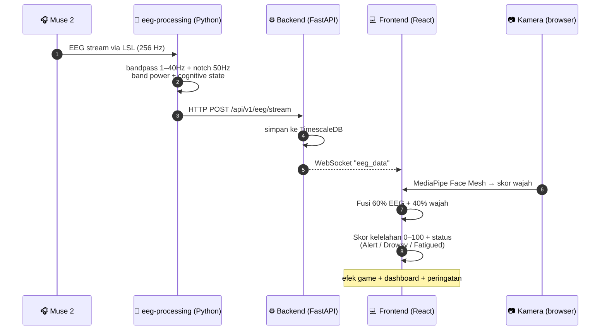
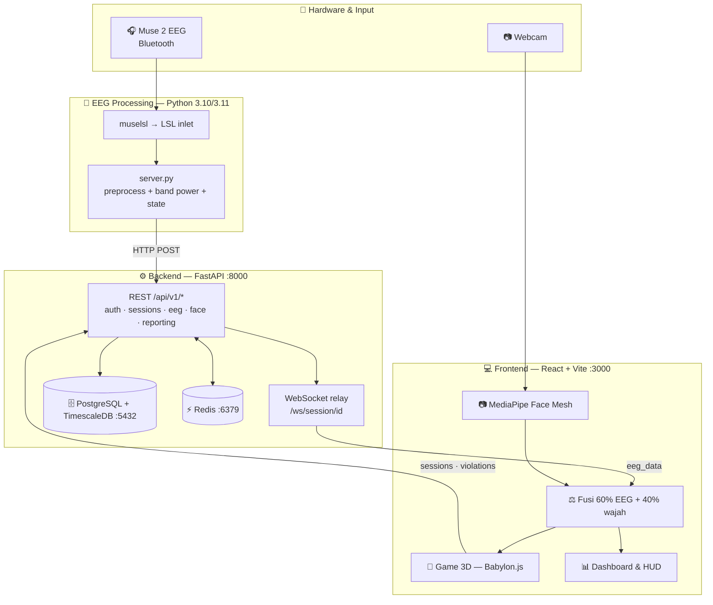
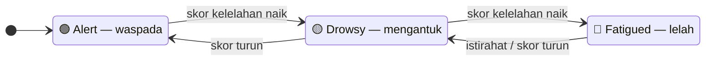

<div align="center">

# 🚗 Fumorive

### Simulasi Berkendara dengan Deteksi Kelelahan (EEG + Face Recognition)

Simulator mengemudi berbasis web yang **mendeteksi kelelahan/kantuk pengemudi secara real-time** dengan menggabungkan sinyal otak (**EEG**) dan analisis wajah (**kamera**).

<sub>Dikembangkan dengan nama kerja internal <b>ERGODRIVE</b> · React + Babylon.js · FastAPI · Python (Muse 2 / LSL)</sub>

</div>

---

## 📑 Daftar Isi
1. [Ringkasan Produk](#1-ringkasan-produk)
2. [Fitur Utama](#2-fitur-utama)
3. [Cara Kerja (Alur End-to-End)](#3-cara-kerja-alur-end-to-end)
4. [Arsitektur Sistem](#4-arsitektur-sistem)
5. [Detail Simulasi Berkendara](#5-detail-simulasi-berkendara)
6. [Deteksi Kelelahan](#6-deteksi-kelelahan)
7. [Output & Analisis](#7-output--analisis)
8. [Cara Menjalankan](#8-cara-menjalankan)
9. [Tim & Status](#9-tim--status)
10. [Catatan Teknis Penting](#10-catatan-teknis-penting)

---

## 1. Ringkasan Produk

**Fumorive** adalah aplikasi simulasi berkendara 3D yang berjalan di browser dan terintegrasi dengan dua sumber data biometrik:

- **EEG** dari headband **Muse 2** (4 channel: TP9, AF7, AF8, TP10) → mengukur aktivitas gelombang otak.
- **Kamera** + **MediaPipe Face Mesh** → mengukur tanda kelelahan dari wajah (mata, mulut, posisi kepala).

Saat pengguna mengemudi di simulator, sistem menganalisis kedua sinyal tersebut, menghitung **skor kelelahan gabungan (0–100)**, dan menampilkan status **Alert / Drowsy / Fatigued** secara langsung — sekaligus merekam semuanya untuk dianalisis setelah sesi selesai.

### Masalah yang diselesaikan
Kelelahan dan microsleep adalah penyebab utama kecelakaan lalu lintas, namun sulit dideteksi oleh pengemudi sendiri. Fumorive menyediakan **lingkungan latihan/penelitian yang aman** untuk mempelajari, mengukur, dan menyadarkan pola kelelahan saat berkendara — tanpa risiko di jalan nyata.

### Untuk siapa
- **Penelitian & edukasi** keselamatan berkendara dan fatigue.
- **Pelatihan kesadaran** pengemudi terhadap kondisi kantuk.
- **Pengumpulan data** multimodal (EEG + wajah + perilaku berkendara) untuk analisis.

---

## 2. Fitur Utama

| Fitur | Deskripsi |
|-------|-----------|
| 🧠 **Monitoring EEG real-time** | Streaming gelombang otak Muse 2 → band power (Delta/Theta/Alpha/Beta/Gamma) → status kognitif. |
| 📷 **Deteksi wajah** | EAR (kedipan/mata tertutup), MAR (menguap), PERCLOS, head pose — berjalan lokal di browser (video tidak ditampilkan/disimpan, demi privasi). |
| ⚖️ **Fusi multimodal** | Skor kelelahan terpadu = **60% EEG + 40% wajah**; fallback ke satu modalitas bila yang lain tidak tersedia. |
| 🚗 **Simulator 3D** | Mobil dengan fisika berkendara (Babylon.js): kemudi, transmisi (auto/manual), kamera 1st/3rd person, drift. |
| 🗺️ **Beberapa peta** | Solo City, Sriwedari Park, dan **Ngawi City** (peta grid **dinamis/prosedural, 3 level**). |
| 🏁 **Misi checkpoint** | Rute waypoint dengan kompas penunjuk arah, timer, dan progres checkpoint. |
| 🚦 **Sistem pelanggaran** | Tabrakan, melawan arah, dll. dicatat sebagai poin pelanggaran. |
| 🚙 **Lalu lintas NPC** | Mobil NPC berkendara di jalan (khusus Ngawi City) — menabraknya menambah poin pelanggaran. |
| 📊 **Analisis sesi** | Laporan pasca-sesi: timeline fatigue, brain wave, pelanggaran, metrik kendaraan, nilai performa, ekspor CSV/JSON. |
| 🔐 **Akun & riwayat** | Login email/password atau Google (Firebase), riwayat sesi tersimpan. |

---

## 3. Cara Kerja (Alur End-to-End)

Dua sinyal biometrik diproses paralel, lalu digabung menjadi satu skor kelelahan yang menggerakkan game, dashboard, dan peringatan:



**Langkah singkat:**
1. **Akuisisi** — Muse 2 mengalir via Bluetooth; `muselsl` mengekspos sebagai LSL stream (256 Hz). Python `server.py` menariknya.
2. **Pemrosesan EEG** — bandpass 1–40 Hz + notch 50 Hz, koreksi baseline, Welch PSD → band power & rasio (θ/α, β/α), lalu klasifikasi state dengan hysteresis.
3. **Ingest** — `server.py` mengirim (HTTP POST) ke backend; backend merelay ke frontend lewat WebSocket dan menyimpan ke database.
4. **Deteksi wajah** — berjalan paralel di browser, menghasilkan skor wajah.
5. **Fusi** — `useFusionScore` menggabungkan 60/40 menjadi indeks kelelahan terpadu yang dipakai game & dashboard.
6. **Persistensi** — sesi, pelanggaran, event wajah/game tersimpan untuk playback, laporan, dan ekspor.

---

## 4. Arsitektur Sistem

Tiga subsistem utama: **Frontend** (browser), **Backend** (API + relay), dan **EEG Processing** (middleware Python di komputer lokal pengguna).



| Subsistem | Lokasi | Peran | Stack |
|-----------|--------|-------|-------|
| **Frontend** | `frontend/` | SPA: game 3D, dashboard, monitoring EEG/kamera, fusi, auth | React 19, TypeScript, Vite, **Babylon.js 8**, Zustand, MediaPipe, Firebase, D3.js |
| **Backend** | `backend/` | API REST + WebSocket relay, auth, sesi, ingest EEG/wajah, laporan, ekspor | FastAPI, PostgreSQL + **TimescaleDB**, Redis, JWT + Firebase, Prometheus |
| **EEG Processing** | `eeg-processing/` | Middleware Python: akuisisi Muse 2 (LSL), pemrosesan sinyal, kirim ke backend | Python 3.10/3.11, muselsl, pylsl, NumPy, SciPy |

**Port default:** Frontend `:3000` · Backend `:8000` (REST `/api/v1/*` + WebSocket) · PostgreSQL/TimescaleDB `:5432` · Redis `:6379`.

---

## 5. Detail Simulasi Berkendara

### Peta
- **Solo City** — kota urban tangan-dibuat dengan ring road, gedung, dan banyak obstacle.
- **Sriwedari Park** — taman terbuka untuk latihan bebas (tanpa misi checkpoint).
- **Ngawi City** — **kota grid yang di-generate acak setiap permainan** (seeded), dengan **3 level** berurutan. Selesai satu level → opsi lanjut ke level berikutnya (peta & rute baru). Kesulitan sama antar-level untuk saat ini.

### Gameplay
- **Misi checkpoint**: pemain mengikuti rute waypoint berurutan; ada kompas penunjuk arah, jarak, dan timer. Selesai rute → halaman analisis hasil.
- **Kontrol**: `K` nyalakan mesin · `WASD` bergerak · `SPACE/SHIFT` rem · `V` ganti kamera · `C` mode steering · `X` transmisi (auto/manual).
- **Lalu lintas NPC** (Ngawi City): 5 mobil NPC (model dibuat via script) berkendara mengikuti jaringan jalan; menabraknya saat melaju menambah poin pelanggaran.

### Sistem Pelanggaran (poin)
| Jenis | Poin | Keterangan |
|-------|------|------------|
| Menabrak objek (collision) | 10 | Termasuk menabrak gedung, pembatas, atau mobil NPC |
| Melawan arah (wrong-way) | 15 | Deteksi lajur kiri (konvensi Indonesia) |
| Melebihi kecepatan | 5 | — |
| Melanggar lampu merah | 20 | — |
| Keluar jalur | 3 | — |

> Tabrakan punya cooldown 1.5 detik agar satu benturan tidak dihitung berulang. Poin pelanggaran hanya bertambah saat **pemain** yang menabrak (berdasarkan kecepatan tumbukan pemain).

---

## 6. Deteksi Kelelahan

### Dari EEG (band power)
| Band | Frekuensi | Indikasi |
|------|-----------|----------|
| Delta | 1–4 Hz | tidur dalam |
| Theta | 4–8 Hz | kantuk |
| Alpha | 8–13 Hz | rileks/tenang |
| Beta | 13–30 Hz | fokus/konsentrasi |
| Gamma | 30–45 Hz | pemrosesan tinggi |

Indikator utama kantuk = rasio **Theta/Alpha** yang tinggi; sistem juga memantau β/α (stres/fokus) dengan baseline per sesi.

### Dari wajah (kamera)
- **EAR** (Eye Aspect Ratio) → mata tertutup / kedipan.
- **MAR** (Mouth Aspect Ratio) → menguap.
- **PERCLOS** → persentase waktu mata tertutup (indikator microsleep).
- **Head pose** (yaw/pitch/roll) → menunduk/menoleh.

### Status akhir
Skor terpadu dipetakan ke tiga status, ditampilkan real-time dan memicu peringatan:



---

## 7. Output & Analisis

Setiap sesi menghasilkan **halaman Hasil Analisis**:
- Durasi sesi & timeline skor fatigue.
- Analisis brain wave (rata-rata tiap band).
- Ringkasan & rekomendasi otomatis.
- Analisis pelanggaran (jenis & jumlah).
- Metrik kendaraan (kecepatan rata-rata, tabrakan, penyimpangan jalur, jarak).
- **Nilai performa (A–D)** berdasar fatigue, tabrakan, dan durasi kantuk.
- **Ekspor CSV / JSON** dan penyimpanan ke riwayat.

---

## 8. Cara Menjalankan

Entry point utama (Windows): **`start_game.ps1`** — mengorkestrasi semua layanan. Manual:

```bash
# 1) Database & cache (Docker): TimescaleDB :5432 + Redis :6379   → lihat DATABASE_SETUP.md

# 2) Backend
cd backend
uvicorn main:app --reload --port 8000      # Swagger: http://localhost:8000/api/docs
#   ⚠️ jalankan migrasi dulu:  python run_migration.py

# 3) Frontend
cd frontend
npm install && npm run dev                 # http://localhost:3000

# 4) EEG (opsional, butuh Muse 2)
muselsl stream
python eeg-processing/server.py --session-id <SESSION_ID> --backend-url http://localhost:8000
```

> Tanpa Muse 2, aplikasi tetap berjalan normal dengan monitoring kamera saja. Panduan rinci: `RUN_GAME.md`, `EEG_SETUP_GUIDE.md`, `FIREBASE_SETUP.md`.

---

## 9. Tim & Status

**Tim (5 peran):** Front End · Back End · Game Logic · Asset & UI · Data Analyst & EEG Engineer.

**Timeline:** mulai 7 Januari 2026 · target ideal 13 Februari 2026 · target maksimal 20 Februari 2026.

**Repository:** [`github.com/Apypz/Fumorive`](https://github.com/Apypz/Fumorive)

---

## 10. Catatan Teknis Penting

- **EEG processing terkunci di Python 3.10/3.11** (muselsl belum kompatibel dengan 3.12+).
- **Video kamera tidak pernah ditampilkan atau dikirim** — hanya metrik wajah yang dihitung lokal (privasi).
- **Konfigurasi sensitif** (kredensial DB, `SECRET_KEY`, kunci EEG, Firebase) wajib diisi lewat `.env` dan tidak ikut di-commit.
- Skor fusi (60/40), ambang EAR/MAR, dan parameter peta Ngawi bersifat **tunable** di kode.

---

<div align="center">
<sub>Dokumen ini adalah gambaran umum produk. Detail arsitektur backend: <code>backend/passed/ARCHITECTURE.md</code> · diagram alur: <code>workflow.mermaid</code></sub>
</div>
